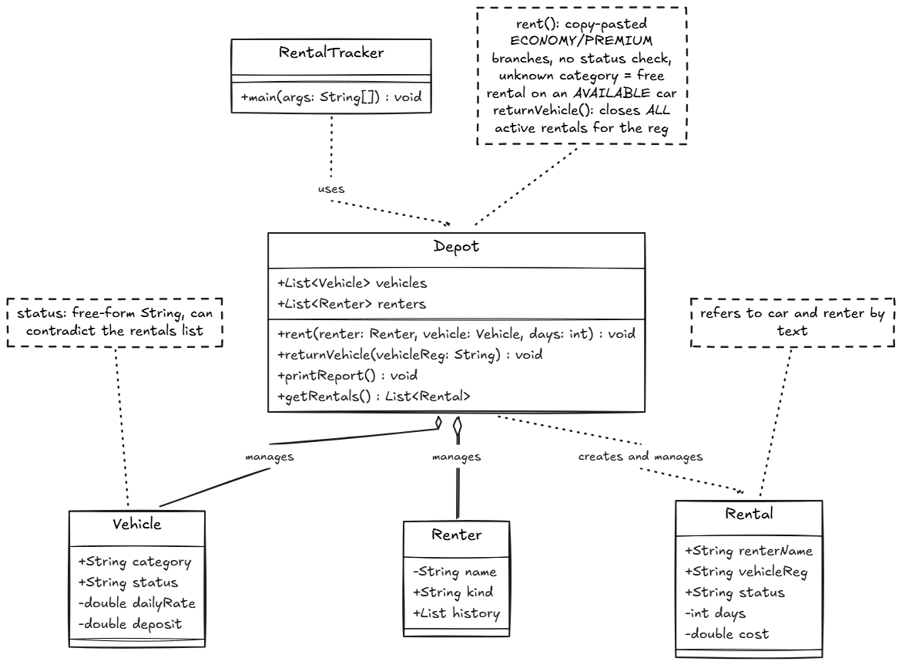
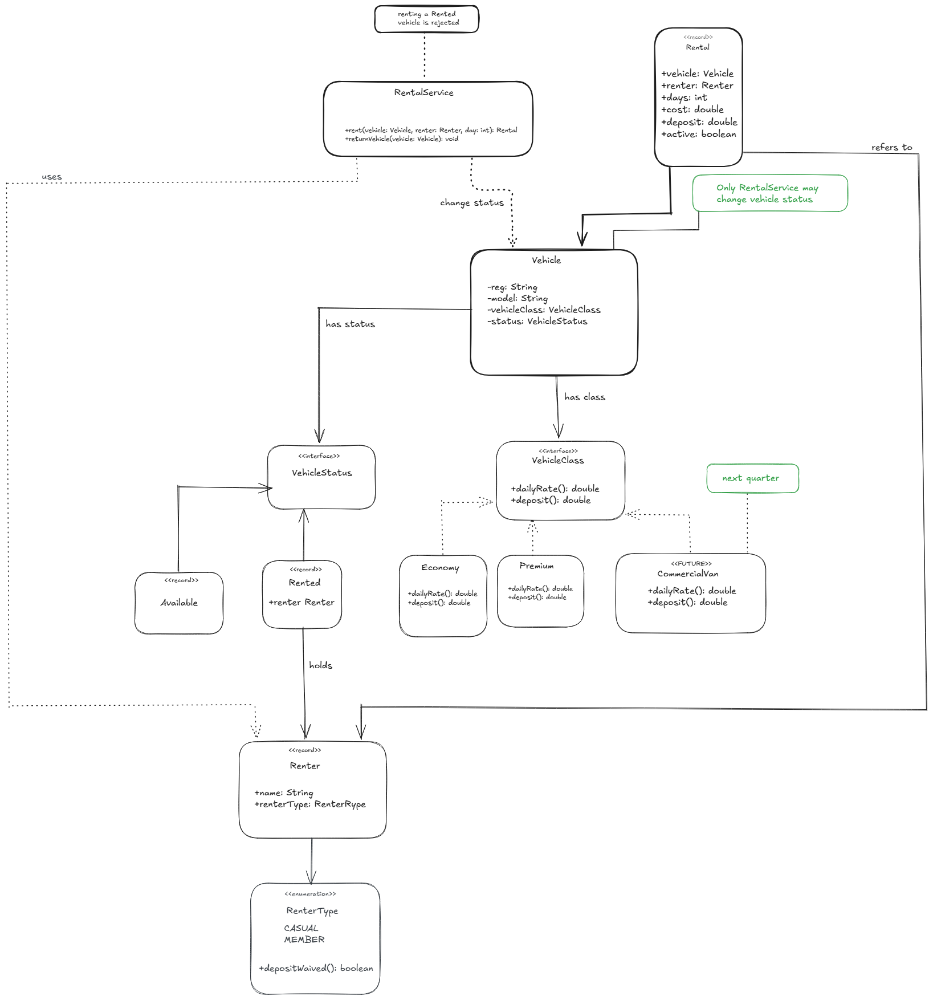

# Diagnosis: Dovewing Car Rentals Tracker

This was written before I changed any code. It covers what is wrong with the starter program, why it happens, and what it could cost Dovewing. At the end I describe the structure I plan to build.

## 1. What I did

I ran the original `RentalTracker` program first, then read through the code. The output I got is saved in [`docs/initial-output.txt`](docs/initial-output.txt) so I can compare against it after the rebuild.

The program does what it says in a simple demo. The trouble is in how it is built. All the rules sit in one file, anyone can change any value, and nothing stops the program from reaching a wrong state.

## 2. The most dangerous problem

**A car that is already rented can be rented again, and the program does not notice.**

In the demo, the Toyota Vitz is rented to Kofi (rental #1). Later the program rents the same car to Ama (rental #3). The end-of-day report then shows the Vitz as `RENTED` with two active rentals. Nothing blocks it and nothing warns the user.

I think this is the worst problem for Dovewing, for four reasons:

- **Two customers can be promised one car.** Dovewing is a small depot with a small fleet. If two people turn up for the same car, one of them leaves without a car.
- **One return wipes out both records.** `returnVehicle` closes every active rental for that registration number. Returning the Vitz once would mark Kofi's rental and Ama's rental as returned, so the history and the money records would be wrong.
- **It explains the paper backup.** The tool can contradict itself, so the staff cannot trust it. If they have to double-check everything on paper, the tool is not helping them.
- **It fails quietly.** There is no error. The problem only shows up when a customer is standing at the counter.

The owner said the one rule that must never be broken is that a car is either available or rented, never both. This problem breaks exactly that rule, so it comes first.

**Why it happens:** the program keeps the same fact in two places. `Vehicle.status` is a plain text value, and the list of rentals also says whether a car is out. Nothing links the two, and `rent()` never checks the current status before renting.

## 3. Other problems

### 3.1 An unknown vehicle category gives a free rental

`rent()` only handles the categories `"ECONOMY"` and `"PREMIUM"`. If the category is anything else, for example a typing mistake or the new van class, both branches are skipped. The program still records a rental with a cost of 0 and a deposit of 0, and the car stays `AVAILABLE`.

- **Why it happens:** the category is plain text compared with `equals`, and there is no `else` branch to catch anything unexpected.
- **Risk:** this is the "available and rented at once" problem again, plus a rental with no payment and no deposit. It is also what would happen when commercial vans are added.

### 3.2 Pricing and deposit rules are copied for each vehicle class

The ECONOMY and PREMIUM branches of `rent()` are identical. They use the same cost formula, the same deposit rule, the same member waiver, the same status change and the same print line.

- **Why it happens:** the vehicle class is handled with `if/else` on a piece of text, so every class gets its own copy of the same code.
- **Risk:** every rule change has to be made in each copy, and it is easy to change one and forget the other. A premium pricing tweak that broke economy returns is a sign of exactly this. A new class would mean a third copy.

### 3.3 One method does too many jobs

`Depot.rent()` works out the price, applies the deposit rule, changes the car's status, prints to the screen, updates the renter's history and creates the rental record. `returnVehicle()` and `printReport()` also print their own text.

- **Why it happens:** nothing separates pricing, record keeping and display.
- **Risk:** a small change in one job can break another. It is also hard to test the rules without running the whole program and reading what it prints.

### 3.4 Everything is public

The fields of `Vehicle`, `Renter` and `Rental` are public, including `status`, `dailyRate` and `deposit`. The `vehicles` and `renters` lists in `Depot` are public too, and `getRentals()` hands out the real internal list.

- **Why it happens:** the classes do not protect their own data.
- **Risk:** any line of code can put the program into a wrong state, so the rule "available or rented, never both" cannot be guaranteed. It could only be checked in one place if only one place could change the data.

### 3.5 Text is used where fixed choices are needed

The vehicle category, the renter type (`"CASUAL"` or `"MEMBER"`), the vehicle status and the rental status are all plain text.

- **Why it happens:** text was used instead of a type that only allows the valid options.
- **Risk:** a spelling mistake compiles without any complaint and then fails silently. For example, if `"MEMBER"` were mistyped, members would start paying the deposit and nobody would see an error.

### 3.6 Returns are not checked

`returnVehicle` sets the car to `AVAILABLE` and closes every matching active rental, with no checks. Returning a car that was never rented still prints "Returned". The loop also never stops at the first match.

- **Why it happens:** return is not treated as a change that is only allowed from the `RENTED` state.
- **Risk:** returns can erase real records (see section 2) or report a return that never happened.

### 3.7 Rentals point to cars and renters by text

A `Rental` stores the renter's name and the car's registration as text, and returns find rentals by matching that text.

- **Why it happens:** the record keeps copies of text instead of pointing to the real objects.
- **Risk:** two renters with the same name cannot be told apart, and a typo in a registration breaks the link between a car and its rental.

### 3.8 There are no input checks

The number of days can be zero or negative, which gives a zero or negative cost. A `null` car or renter is not checked. The same registration number can be added to the fleet twice.

- **Why it happens:** nothing checks values when objects are created or used.
- **Risk:** wrong charges, crashes at the front desk, and two cars the system cannot tell apart.

### 3.9 Money is stored as `double`

Rates, costs and deposits are all `double`.

- **Why it happens:** a floating-point type was used for money.
- **Risk:** small rounding errors can appear once discounts, tax or part-day rates are added. It is fine for the demo numbers, so I will leave it as it is for now (to keep the output identical) and note it as a known limit.

### 3.10 IDs come from shared counters

`Vehicle`, `Renter` and `Rental` each get their ids from a `static int counter`.

- **Why it happens:** the ids depend on hidden shared state.
- **Risk:** an id depends on how many objects were created before it, so tests cannot start from a clean state, and the counters would not be safe if more than one thread used the program.

## 4. What adding vans would mean in the old code

The depot is adding a commercial-van class next quarter with its own deposit rules. In the starter code I would have to:

1. Add a `"VAN"` text value and a third copy of the branch in `Depot.rent()`.
2. Search for every other place that depends on the category. Missing one causes the free rental in 3.1.
3. Edit the same method that already handles economy and premium, which risks breaking them again.

## 5. Planned structure

### Current structure (before)

### Planned structure (after)

The plan, which may change while I build (I will explain any change in the README):

- **One status value.** A car's status is either `Available` or `Rented`, and only `Rented` carries the rental. A car cannot be both.
- **The vehicle class owns its rules.** Economy and premium each provide their own daily rate and deposit behind one shared type. A new class becomes one new type instead of changes to `rent()`.
- **The renter type owns the waiver.** Whether a deposit is waived belongs to the renter type (casual or member), separate from the vehicle rules.
- **The car guards its own status.** Renting a rented car and returning an available car are both rejected, so the rule holds no matter who calls it.
- **Enums and sealed types instead of text** for every fixed set of choices.
- **Private fields, no exposed lists, and real references** instead of copied text.
- **Printing kept apart from the rules.**

The rebuilt program must give the same output as `docs/initial-output.txt`. The one intended difference is that the second rental of the Vitz is rejected.